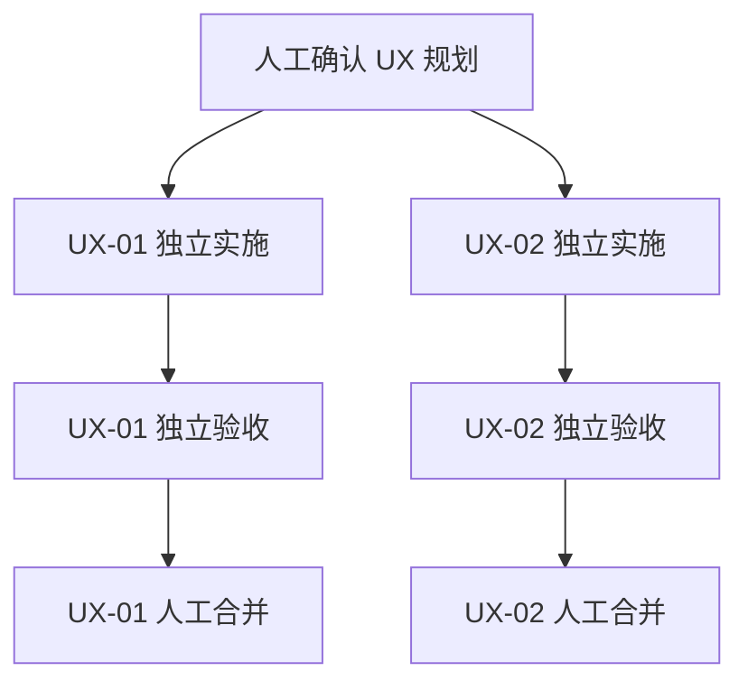
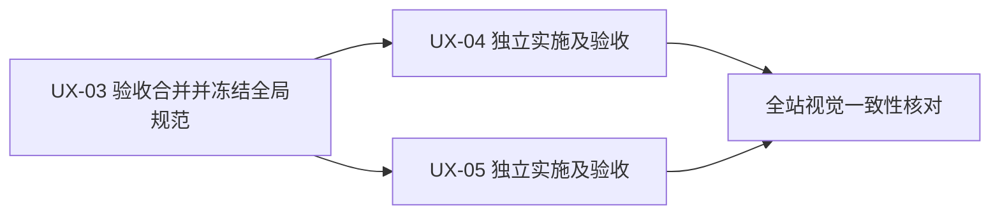

# KnowPilot UX Master Plan

第一批 UX-01、UX-02 已合并并完成定向回归。以下保留当时的基线、约束和依赖。以 GitHub `main` 的 [`97e9cbe`](https://github.com/IUBOBO/KnowPilot/commit/97e9cbef279415f7f62f85f221f10c11d10e5305) 为分析基线。PR #42 合并了八份发布规划文件，发布总 Issue #41 仍按已批准范围执行。依据 [项目规范](../../../AGENTS.md)、[Plan 规范](../../../PLANS.md)、[路线图](../../../ROADMAP.md) 及 [V2 Master Plan](../v2/MASTER-PLAN.md) 复核本轮范围。[PR #42](https://github.com/IUBOBO/KnowPilot/pull/42) · [发布 Issue #41](https://github.com/IUBOBO/KnowPilot/issues/41)

| 任务 | Issue 和 Plan | 单独持有的前端区域 | 实施分支 |
|---|---|---|---|
| UX-01 数据复核二次确认 | [#43](https://github.com/IUBOBO/KnowPilot/issues/43) · [初始 Plan](UX-01.md) | 问答复核、问答专项测试 | `codex/ux-01-review-confirmation` |
| UX-02 统一检索结果可读性与视觉层次优化 | [#44](https://github.com/IUBOBO/KnowPilot/issues/44) · [初始 Plan](UX-02.md) | 检索正文展示、检索专项测试 | `codex/ux-02-search-readability` |

图与 [DEPENDENCIES.json](DEPENDENCIES.json) 一致。规划经确认后分别从最新的已验收主线提交建立独立分支和工作树，两项可同时进行。各自提独立功能 PR，按对应 Issue 验收后由人工合并，再在实际合并 SHA 上复查受影响的路径。任一分支失败或延期时，另一分支可独立交付。

`Modal`、`ConfirmDialog`、`ErrorNotice`、`EvidenceViewer`、全局主题、`api.ts`、路由和 shared 协议均为只读复用。UX-01 专项浏览器测试归问答，UX-02 归检索。两项可运行同一既有回归脚本，若将来确需修改同一个文件，协调者先明确责任和验收，再串行落盘，避免两个分支并行写入。实施中每节点对照 Master Plan、Issue、对应 Plan 和验收证据。

## 发布范围建议

建议保持 V2.0.0 已批准范围，这两项进入后续维护版本。UX-01 有减少误触发外部模型请求及费用的收益，如发布前确需取舍，可优先考虑 UX-01。UX-02 适合单独排期。目前发布候选计划在发布文档合并后冻结，规划 PR 仅含文档。若规划文件先进入最终候选，R5 仍需将新增文档计入候选树与源码归档审查，业务验收范围不变。[正式发布计划](../v2/V2.0.0-RELEASE-PLAN.md) · [发布 DAG](../v2/release/DEPENDENCIES.json)

若用户明确决定将一项或两项纳入 V2.0.0：

1. 单独批准发布范围变更，更新 #41、发布计划和发布 DAG。每项保留独立功能 PR。将所选任务的验收、人工合并及实际合并后的复查放在发布候选的 R5 合并前复审及 R6 冻结之前，复核已开始或已完成的 R1–R4 证据受影响部分。涉及使用路径或截图时，R1/R2 文档同步，R3 在含 UI 实现的候选重新构建和验证。无迁移变更时，R4 复核此前演练证据的适用性。
2. R5 初审和合并前复审涵盖所选实现。UX-01 核对云端同意、权限、重复提交和用量边界，UX-02 核对结果、引用、权限及交互兼容。R6 更新版本说明预览；以实际候选树完成 R5 合并后审查和定向回归，再冻结新 SHA。如果已有冻结候选，先暂停发布并审查重新冻结的 SHA。
3. 标签和 Release 仍分别等待针对新候选的明确授权。当前 UX DAG 不连到任何 R1–R6 节点。

## 第一批规划交付与校验

第一批规划包含本目录下两个初始 Plan、本文和 JSON 依赖图。静态核对 Issue 对应关系、文件范围、节点引用与无环。功能实现、功能测试与实施验收留待开工。

## 全站视觉可读性规划

基线为 [`0a2b73e`](https://github.com/IUBOBO/KnowPilot/commit/0a2b73e7049bd692d3412b964a822b59428db57b)，涵盖 UX-01 [PR #46](https://github.com/IUBOBO/KnowPilot/pull/46) 和 UX-02 [PR #47](https://github.com/IUBOBO/KnowPilot/pull/47)。全站调研与浏览器实测见 [检查矩阵](VISUAL-AUDIT.md)。

| 任务 | Issue | Plan | 文件所有权 |
|---|---|---|---|
| UX-03 全站主题配色与文字层级规范优化（P0） | [#48](https://github.com/IUBOBO/KnowPilot/issues/48) | [UX-03.md](UX-03.md) | 全局 index.css、a-theme.css 和公共表现样式。必要时单独调整加载入口 |
| UX-04 长文本阅读与 Agent 交互展示优化 | [#49](https://github.com/IUBOBO/KnowPilot/issues/49) | [UX-04.md](UX-04.md) | 问答、检索、原文阅读、笔记、知识沉淀/审核、数据集整理的局部组件与样式 |
| UX-05 科研台账与管理后台信息层级优化 | [#50](https://github.com/IUBOBO/KnowPilot/issues/50) | [UX-05.md](UX-05.md) | 工作台、知识库列表、科研台账、数据集管理/上传及其余后台的局部组件与样式 |

UX-03 经人工验收合并，在实际 SHA 上核对两套主题和公共组件，冻结 Token 名称、样式适用场景及不会回归的 UI 合约。随后 UX-04、UX-05 各自开分支和工作树并行，分别提交 PR。冻结后两项均只读全局 CSS。确需改公共文件时，由协调者登记、批准并串行提交。知识审核及整理为 UX-04，其他管理场景归 UX-05。[机器可读依赖](DEPENDENCIES.json)

两项实施结束后用同一组亮暗主题、代表视口和合成场景复核所有页面矩阵，避免重复截图。UX-01 二次确认和 UX-02 检索卡片、高亮及展开为共同回归项。这三个 Issue 独立于 V2.0.0 发布范围。当前 PR 仅含规划和浏览器基线记录。
