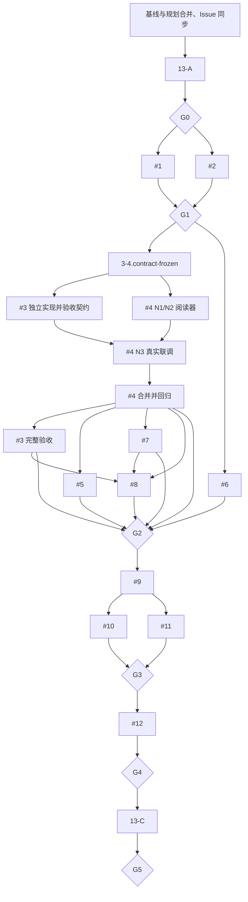

# KnowPilot V2 总体实施计划 v1.1

状态：统一规划已获批准；基线 PR [#14](https://github.com/IUBOBO/KnowPilot/pull/14) 未合并（核验 HEAD `668bb3174d9615c3a3403ad0230b1702be7a026e`，源码参考 `501ee5302cdc8f5a99dc21ae082f0b05b6b2339f`）。实际执行使用审查后的合并 SHA。备份清单和恢复记录已核验；既有工程检查不等同于 #13-A。所有功能及三段评测均待执行。

## 1. PRD 与源码上下文
- 产品决策：保留智能问答、知识检索两个入口，共享检索能力；原左侧导航、中央问答、可折叠右侧证据阅读器。动态回答由受控结构和真实证据驱动；检索过程基于真实事件。笔记默认私有，导出为辅；正式知识须确认入库。台账自动登记、训练自动化、GraphRAG、更换框架不在本期。
- `documents/search.ts` 的 `searchDocuments` 已有关键词/向量检索、RRF 等，`ask-run.ts` 的 `runAsk` 管理工具、EvidencePool、预算、恢复；复用，不重建。`task-router.ts` 有 simple/multi_source/state_lookup。普通检索不强制 LLM。
- `AskPage.tsx` 已有 `AnswerBody`、`FinalAnswerBody`、`CitationPopover`、`QueryDetails`，`ChunkPage.tsx` 可显示原文上下文。`SearchPage.tsx` 是独立入口。`packages/shared/src/answer.ts` 已有文档/记录引用类型。引用存在不等于语义复核；现有独立复核保留。
- `knowledge/generate.ts` 的 `generateDrafts` 与 `knowledge/admit.ts` 的 `admitEntry` 是复用点；未确认知识不进索引。`KnowledgePage.tsx` 提供草案及确认入口。
- 根 package scripts 有 typecheck、test（workspace if-present，不代表所有测试都运行）；web 有 build；server 有 verify-* 与 eval 脚本。现有 server 已依赖 pdfjs-dist，前端仍需评估 worker 与构建。
- 评测：`eval/metrics.ts` 和 `eval/run.ts`；现有 `retrievalHits` 反映 Agent 汇聚结果。原始召回排序、入池/模型可见、最终引用与语义支持分别记录。`eval --offline` 将依赖模型的观测标为 `NOT_RUN`；真实模型须另行授权预算。

## 2. 总体目标与交付阶段
| 锚点 | 开工条件 | 任务 | 必须验证的阶段结果（退出条件） |
|---|---|---|---|
| [G0 工程/质量基线](gates/G0.md) | 本地备份已核验；审查合并 #14 和规划 PR，核对 Issue 同步 | #13-A | 记录实际合并 SHA；隔离数据库/端口；基线测试命令、指标口径和结果已留档；核心安全回归通过，已知旧失败单独批准处置 |
| [G1 公共底座](gates/G1.md) | G0 通过 | #1、#2 | 共用检索契约和问答壳/插槽稳定；旧 API、权限、流式历史、续跑回归通过；两个 PR 已合并 |
| [G2 检索体验](gates/G2.md) | G1 通过 | #3、#4、#5、#6、#7、#8 | 实际演示：检索聚合→选文档→范围问答→动态引用→右栏/PDF→返回检索；错误/权限/历史及真实 trace 均通过；六个 PR 已合并 |
| [G3 研究成果](gates/G3.md) | G2 通过 | #9、#10、#11 | 回答→私有笔记→编辑/导出→草稿→人工确认的可追溯闭环；权限、未确认不可检索、增量迁移通过；三个 PR 已合并 |
| [G4 主动沉淀](gates/G4.md) | G3 通过 | #12 | 低干扰触发、六类匹配与冲突、幂等重试、人工审核及确认前索引不变通过；PR 已合并 |
| [G5 最终交付](gates/G5.md) | G4 通过且 #1–#12 均已合并 | #13-C | 同口径前后评测、UI/端到端回归、权限与降级验收报告；未运行/已知不足如实披露；人工批准最终 PR 且验证实际合并 SHA 后，才可处理 #13 的关闭 |

#13-B 贯穿 G1–G4，不是一个等待所有功能才开工的普通节点。每个功能 PR 自带单测与回归证据；评测负责人维护质量矩阵。#13-A 可在独立评测 PR 或批准的基线报告提交中落地；不要用 Closes #13 提前关闭；最终 PR 才关闭。

## 3. DAG 与执行波次
依赖以 [DEPENDENCIES.json](DEPENDENCIES.json) 为准；节点就绪、PR 及验收状态由协调者写入 [EXECUTION-STATE.json](EXECUTION-STATE.json)。开工、节点内、联调、合并、阶段门禁、评测是独立边类型，所有指向同一节点的前置条件均须满足。

每项功能的 13-B 合并前验证进入 PR 门禁，合并后回归成功才释放契约。#3 的 `3.released` 仅释放联调契约，`3.full-accepted` 才代表 Issue 验收完整。#4 的 N3 和合并只等待 `3.released`；#4 合并回归后才释放 `3.full-accepted`。阶段性 PR 使用 `Refs #3`。

硬依赖以 `DEPENDENCIES.json` 为准，包含开工门禁和合并门禁。阶段门禁是额外的质量约束（并非把所有上游改成模块硬依赖）。相对原计划主动收紧 #6→#1/#2、#7→#4、#8→#3/#4/#7，以避免完整验收依赖未落地的组件。#3 与 #4 无循环阻塞：共同冻结回调契约；#3 以 fixture 验证回调，#4 独立实现 viewer，#3 先合并后 #4 完成实际联调。同步后的现有 Issue、Plan 和 ROADMAP 使用同一口径。

| 波次 | 可并行实现（同一时刻） | 交付/合并策略 |
|---|---|---|
| W0 | 基线和规划合并、Issue 同步 → 13-A | 顺序，G0 |
| W1 | #1、#2 | 冻结公共协议；建议 #1 后 #2 顺序合并并重跑测试，G1 |
| W2 | #3、#4、#6 | 先冻结 #3/#4 回调、#6 事件与文件所有权；建议 #3→#4→#6 合并，共享文件由协调者接线 |
| W3 | #5、#7（#4 合并后，#6 若仍独立可继续） | #5/#7 无硬顺序；共享 viewer 只由协调者接线，建议 #5→#7 |
| W4 | #8（#3/#4/#7 合并后） | G2 全链路验收；其他独立任务可完成但不得越过 G2 |
| W5 | #9 | 笔记模型/权限/迁移先合并 |
| W6 | #10、#11 | 导出与草稿分别实施；共享笔记入口串行接线，建议 #10→#11，G3 |
| W7 | #12 | G4 |
| W8 | 13-C | G5；最终 PR 验收合并后，由人工批准处理 #13 |

上述波次是便于管理的建议顺序，不必等待无关任务才启动已满足依赖的同阶段任务。每次派发先由协调者检查真实依赖状态。不能同时修改同一文件/迁移序列。并行执行不等于并行合并。

## 4. Coordinator 与 Subagent
- Coordinator 是 Codex 主任务，维护 DAG、阶段报告、Plan 版本、公共接口、文件锁/所有权、分支与验收记录；由协调者单写执行状态文件，负责共享文件集成、PR 顺序。只有协调者在获得用户批准后执行合并；若工具无法创建 subagent，则使用多个独立 Codex 对话/工作树实现同样分工。
- #1 backend、#2 chat UI、#3 answer composer、#4 reader、#5 PDF、#6 trace、#7 search UI、#8 context、#9 notes core、#10 export、#11 draft、#12 lifecycle、#13 QA/eval。每个任务只有一个交付负责人，可委派只读审查/测试给独立 agent。
- 每个任务从满足依赖的最新合并 SHA 派生独立分支与工作树，如 feat/v2-03-answer-blocks。独立 DB/fixture/端口。不可使用生产 .env，禁止对原运行目录执行 reset/clean、覆盖数据。不得把本地真实路径、密钥、个人信息、私有资料或日志推到公共 GitHub。
- 高风险共享文件：`app.ts`、`ask-run.ts`、`packages/shared/src/answer.ts`、`AskPage.tsx`、`db/migrations.ts`、路由/权限、lockfile。各 agent 优先新增独立模块，修改这些文件先登记所有权；有冲突由协调者串行接线。下游不得基于尚未合并的实现假定接口稳定，唯一例外是已冻结契约上的隔离 fixture/只读规划。

## 5. 生命周期及节点一致性门禁
1. 规划：核对 PRD、最新 Issue、现有源码和基线；总计划 + 13 份初始 Plan 一次性评审，不一次性实现。后续开工时只根据新 SHA 修订必要细节，版本可追溯；不能无声改目标。
2. Ready：前置 gate、硬依赖已合并且验收通过，接口/文件所有权确定，Plan 获批。任务状态 Planned→Blocked/Ready→In progress→Review→Accepted→Merged；失败返回 In progress，不能越级。
3. 单节点执行：读计划和节点标准→实施→运行相应测试→独立对照（如下）→发现偏差修正并复测→通过后记录并开始下一节点。保留客观证据，不靠模型评分代替测试。
4. 检查四层一致性：总体目标、Issue 范围与验收、当前 Plan、节点标准。分别标 PASS/FAIL/BLOCKED，引用具体 diff、命令、截图或报告。节点测试未执行不得 PASS；不适用需说明并获批。明确偏差类型（缺失/越界/契约/安全/回归）及修正方案。遇到需求变更先暂停，修订 Issue/Plan/DAG 并确认；不得为了通过降低验收标准。
5. PR 门禁：实际提交范围内的所有节点通过（#3 契约阶段单独标记，完整联动仍待 #4），Issue Checklist 有证据，审查 diff/敏感内容、测试、权限及兼容性；独立 reviewer 检查。协调者检查合并顺序及最新 main 上的冲突/回归，经人工批准合并。合并后验证真实 SHA 与 smoke/回归，通过才释放下游。分支未合并或合并后失败均不算依赖满足。
6. 阶段门禁：列出全部要求、合并 SHA、测试证据、风险及实际演示；用户批准后在状态记录中标记 gate PASS。关键安全或回归失败阻塞后续；仅可继续不写代码的分析与计划修订。不可无限循环修正：同类问题连续两轮修正仍失败，或发现跨范围风险，标记 BLOCKED 并请求决策。

### 节点记录模板
| 项目 | 实际记录 |
|---|---|
| Issue / Plan 版本 / 节点 / 基线 SHA | |
| 预期输入和输出 | |
| 实际修改、commit/diff | |
| 测试命令、fixture、结果/证据路径 | |
| 总体计划一致性 | PASS / FAIL / BLOCKED + 理由 |
| Issue 一致性 | PASS / FAIL / BLOCKED + 理由 |
| Issue Plan 一致性 | PASS / FAIL / BLOCKED + 理由 |
| 节点标准一致性 | PASS / FAIL / BLOCKED + 理由 |
| 偏差、修正、复验 | |
| 下一节点是否释放、审核者 | |

### 阶段锚点报告模板
Gate ID、预期、关联 Issue/PR/SHA、实际演示、回归命令/结果、失败/跳过/未运行、风险、审核者、PASS/BLOCKED、下一波可执行任务。

## 6. 统一交付物
每个 Issue：最新正文（需求契约）、独立 Plan（版本+节点记录）、源码 diff、测试证据、必要的安全审查和 UI 截图、PR、合并 SHA。总体：本 Master Plan、DAG、阶段验收记录、改造前后评测报告。Github Issue 是正式需求来源，仓库 Plan 是实施依据，不能形成两个相互矛盾的版本。正文更新保留已有评论及 Issue 编号。

## 7. 初始状态
#1–#13 已创建，初始计划已编写，全部未执行。基线合并及实际评测状态需 Codex 本地核验。统一规划已批准；文档和 Issue 一致，基线与规划 PR 均经人工合并后，另行批准执行 G0。后续按 DAG 派发，不一次性实现全部任务。
