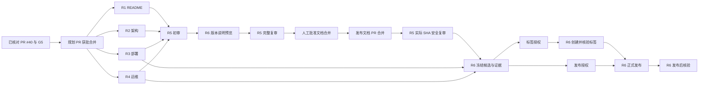

# KnowPilot V2.0.0 发布 Master Plan

本计划将已批准的发布检查清单落到 Issue #41、六个任务及可检查的依赖。规划 PR 待审，R1–R6 尚未启动。[正式发布 Issue](https://github.com/IUBOBO/KnowPilot/issues/41) · [已合并的发布计划](https://github.com/IUBOBO/KnowPilot/blob/e077d662783f69de525d598c0ee9679603199006/docs/plans/v2/V2.0.0-RELEASE-PLAN.md)

## 基线与边界

- 发布准备基线为 PR #40 的实际合并 SHA `e077d662783f69de525d598c0ee9679603199006`。GitHub `main`、本地 `main` 与 `origin/main` 已核对。G5.pass 已归档，Issue #13 已按 `completed` 关闭。[G5 报告](../gates/G5.md) · [执行状态](../EXECUTION-STATE.json)
- 保留 G5 的自动化历史、未运行项目、G5-A 整体手测和三项 G5-B 用户自测的证据归属。本轮只做发布规划与文档一致性核对。
- 业务源码、数据库迁移、依赖、package 及 SERVICE_VERSION 保持已验收版本。产品 Git 标签拟为 `v2.0.0`。内部 `0.1.0` 的显示关系按已批准 Plan 在发布文档和说明中披露。
- 使用现有 README、技术文档、[证据回调契约](../contracts/EVIDENCE-OPEN.md) 和阶段材料。文档开工时查找同主题文件，优先更新，其余说明交叉链接。
- 生产配置、真实数据库、科研资料及原始日志保留在本地。隔离安装、启动、演练使用合成数据、独立数据库、上传目录和回环端口。涉及实际生产数据、外部模型或 BGE-M3 实机的工作按明确授权另行处理。

## 任务与文件所有权

| 任务 | 默认文件边界 | 交付 |
|---|---|---|
| [R1](R1.md) README | 仓库根 README.md | 更新产品入口、快速启动与文档导航 |
| [R2](R2.md) 系统与 Agent 架构 | 现有同主题文档，缺失时 docs/architecture.md | 系统边界、Agent 执行、源码与阶段证据 |
| [R3](R3.md) 安装部署及配置 | 现有同主题文档，缺失时 docs/deployment.md | 部署文档、隔离启动和同源托管证据 |
| [R4](R4.md) SQLite v38、备份恢复及运维 | 现有同主题文档，缺失时 docs/operations.md | 运维文档、隔离升级、恢复和回滚证据 |
| [R5](R5.md) 安全审查 | 发布 PR 的审查记录与脱敏证据索引 | 合并前初审、完整复审及实际候选复审 |
| [R6](R6.md) 版本说明与发布 | 发布 PR 的 Release Notes 预览、冻结候选报告及获批后的 GitHub 对象 | 版本说明、候选 SHA、标签和 Release 核对 |

规划 PR 经人工审查并合并后，由协调者核对实际 main，从该基线创建发布文档分支与隔离工作树。R1–R4 可在分离文件边界内并行。需要引用对方成果的链接、命令和路径在集成时核对。若现有文档复用导致共享文件，由协调者安排单一写入顺序。合并前集成为一个发布文档 PR，规划 PR 与发布文档 PR 分开审查。

## 发布 DAG

[机器可读依赖图](DEPENDENCIES.json)区分开工、联调、合并、证据和人工授权。R5 初审与完整复审分别登记，R6 的版本说明预览可在标签和发布授权之前完成。发布文档合并后，若 main、候选树、发布说明或拟发布资产发生变化，重新核对受影响证据。人工授权绑定冻结的 SHA 和已审方案。

## 验收与留痕

| 阶段 | 可核验结果 |
|---|---|
| 规划审查 | 本计划、R1–R6 初始 Plan、DAG 与 Issue #41 一致，依赖无环，R1–R4 开工条件相同。 |
| 发布文档 PR 前 | 按六份 Plan 留存源码与命令索引、环境、fixture、退出码、实际所见和限制。完成 R5 初审、Release Notes 预览以及 R5 完整复审。 |
| 文档合并后 | 记录实际 main、commit/tree SHA、三处 main 和归档范围。核对部署、Hono 静态资源、v37→v38 迁移与恢复证据是否覆盖实际候选。若相关输入改变，重新执行受影响的隔离验证。 |
| 正式发布前 | 版本说明预览包含产品标签与内部版本差异和已知限制。记录 tag 占用状态、实际候选 SHA、拟发布资产和两项明确授权。 |
| 正式发布后 | 核对远程标签解析目标、Release URL、版本说明、源码归档与冻结 SHA。保存实际结果并按项目规范收尾 Issue。 |

每个节点以批准的源计划、Issue、对应独立 Plan 和节点标准核对。发现版本、数据一致性、敏感信息或功能范围偏差则暂停相关下游，记录归属并复验。发布失败时保全 Git 记录与候选证据。已有标签保留原指向，发布更正按可追溯记录处理。
